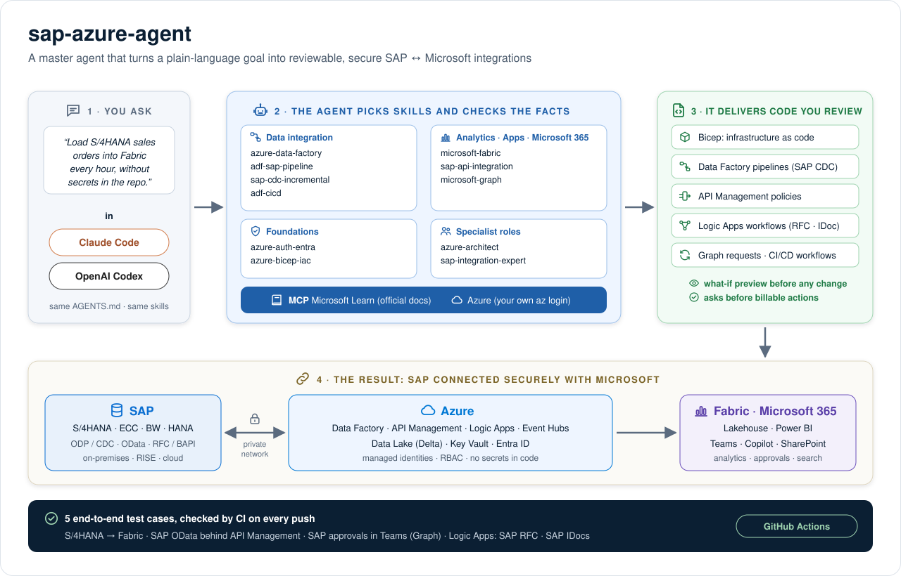

# sap-azure-agent

[](https://github.com/alvrichh/sap-azure-agent/actions/workflows/validate.yml)



A master agent for **Microsoft Azure, Microsoft 365 and SAP integration**. Clone the repository, open it with [Claude Code](https://code.claude.com) or [OpenAI Codex](https://developers.openai.com/codex), and ask in plain language: the agent picks the right skill, checks the official Microsoft documentation, and produces reviewable infrastructure as code, Data Factory pipelines, API policies and step-by-step guidance to connect SAP S/4HANA, ECC, BW or HANA with Azure, Fabric and Microsoft 365.

It also hosts the learning material (SAP generative AI, Microsoft Learn notes) the agent uses as background knowledge.

## Quick start

### 1. Prerequisites

- Claude Code **or** OpenAI Codex (CLI, desktop app or IDE extension).
- Node.js 20+ (runs the Azure MCP server through `npx`).
- [Azure CLI](https://learn.microsoft.com/cli/azure/install-azure-cli), signed in with your own account:

```bash
az login
```

- Optional, for SAP connectivity: network access to your SAP system (self-hosted integration runtime, on-premises data gateway, VPN/ExpressRoute or VNet peering).

### 2. Clone

```bash
git clone https://github.com/alvrichh/sap-azure-agent.git
```

```bash
cd sap-azure-agent
```

### 3. Open it with your agent

**Claude Code**

```bash
claude
```

Approve the two MCP servers (`microsoft-learn`, `azure`) when prompted.

**OpenAI Codex**

```bash
codex
```

Mark the folder as **trusted** so Codex loads `.codex/config.toml` (MCP servers). If your Codex version doesn't load project MCP servers, add them once:

```bash
codex mcp add microsoft-learn --url https://learn.microsoft.com/api/mcp
```

```bash
codex mcp add azure -- npx -y @azure/mcp@latest server start
```

**Windows:** `.claude/skills` is a symbolic link. Enable symlinks before cloning (Developer Mode and `git config --global core.symlinks true`).

### 4. Ask

Describe the outcome you want; you don't need to name the skill. Examples:

- "Design an architecture to load SAP S/4HANA sales orders into Microsoft Fabric every hour."
- "Set up incremental replication of extractor 2LIS_11_VAITM into Delta tables in ADLS."
- "Create the Bicep and ADF JSON to copy SAP table MARA to our data lake, dev environment."
- "Expose the SAP OData service API_BUSINESS_PARTNER through API Management with Entra ID."
- "Notify a Teams channel when a purchase order above 50,000 EUR is created in SAP."
- "Configure GitHub Actions to deploy our Data Factory to test and production without secrets."

More detail: [docs/getting-started.md](docs/getting-started.md). Complete worked examples: [S/4HANA → Fabric](examples/s4hana-to-fabric/README.md), [SAP OData behind API Management](examples/sap-odata-apim/README.md) , [SAP approvals in Teams with Microsoft Graph](examples/graph-teams-approvals/README.md) , [Logic Apps calling SAP RFC](examples/logicapps-sap-rfc/README.md) and [IDocs to and from SAP with Logic Apps](examples/logicapps-sap-idoc/README.md).

Local settings: copy [`.env.example`](.env.example) to `.env` (ignored by Git) and fill in your tenant, SAP hosts and URLs and Snowflake account. Secrets stay in Key Vault; `.env` holds only their names.

## How the agent works

1. **Clarifies the goal**: source and target systems, volumes, latency, where SAP runs (on-premises, RISE, public cloud).
2. **Picks a skill** from `.agents/skills/` and follows its procedure and checklist.
3. **Verifies against Microsoft Learn** (MCP server `microsoft-learn`) before stating connector names, limits or prices.
4. **Produces code you can review**: Bicep, ADF JSON, API Management policies, Graph requests, CI/CD workflows, starting from `templates/`.
5. **Acts on Azure only with your identity** (MCP server `azure` or `az` CLI), previews changes with what-if, and asks before creating, changing or deleting billable resources.

## Skills

| Skill | Use it for |
| --- | --- |
| [`azure-data-factory`](.agents/skills/azure-data-factory/SKILL.md) | Designing and building ADF pipelines, datasets, linked services, integration runtimes, triggers and data flows. |
| [`adf-sap-pipeline`](.agents/skills/adf-sap-pipeline/SKILL.md) | Extracting SAP data (S/4HANA, ECC, BW, HANA) into Azure: choosing the connector, prerequisites, reference architecture. |
| [`sap-cdc-incremental`](.agents/skills/sap-cdc-incremental/SKILL.md) | Delta replication via ODP with the SAP CDC connector into Delta tables: contexts, run modes, checkpoint keys, partitioning, ODQMON operations. |
| [`microsoft-fabric`](.agents/skills/microsoft-fabric/SKILL.md) | SAP analytics on Fabric: ingestion path (ADF + shortcuts, Fabric connectors, Mirroring via Datasphere), capacity, lakehouses, Direct Lake. |
| [`sap-api-integration`](.agents/skills/sap-api-integration/SKILL.md) | Transactional integration: SAP OData behind API Management, RFC/BAPI/IDoc with Logic Apps, Power Platform, SAP BTP / Integration Suite, connectivity. |
| [`microsoft-graph`](.agents/skills/microsoft-graph/SKILL.md) | Microsoft 365 integration: Teams, Outlook, SharePoint, change notifications, least-privilege permissions, Copilot connectors for SAP data. |
| [`azure-auth-entra`](.agents/skills/azure-auth-entra/SKILL.md) | Identity: managed identities, OIDC for CI/CD, RBAC, Key Vault, Entra ID ↔ SAP SSO, provisioning and principal propagation. |
| [`azure-bicep-iac`](.agents/skills/azure-bicep-iac/SKILL.md) | Infrastructure as code: Bicep authoring, parameters per environment, linter, what-if, deployment stacks, CI/CD. |
| [`adf-cicd`](.agents/skills/adf-cicd/SKILL.md) | Data Factory CI/CD: validate/export with the ADF npm package, parameterization, trigger handling, deploy to test and production. |

### Specialist roles

| Role | Focus |
| --- | --- |
| [`azure-architect`](.claude/agents/azure-architect.md) | Solution design on Azure: service choice, networking, identity, security, cost drivers. |
| [`sap-integration-expert`](.claude/agents/sap-integration-expert.md) | SAP side: ODP/CDC, RFC, OData, CDS views, authorizations, Basis prerequisites, licensing questions. |

Claude Code runs them as subagents; in Codex ask it to "act as the azure-architect role".

## Templates

All templates use `<placeholder>` values and contain **no secrets**. Index: [templates/README.md](templates/README.md).

| Area | Files |
| --- | --- |
| Infrastructure (Bicep) | Data factory + ADLS Gen2 + Key Vault with RBAC, Fabric capacity, API Management for SAP OData, GitHub OIDC identity, linter config, parameters per environment |
| Data Factory | Linked services (Key Vault, ADLS Gen2, SAP Table, SAP CDC, SAP OData), datasets, full-copy pipeline, metadata-driven SAP CDC pipeline and control file |
| Fabric | OneLake shortcut to Delta tables |
| API Management | SAP OData policy (sap-client, Key Vault credentials, CSRF token) |
| Microsoft Graph | Sites.Selected grant, list subscription, Copilot connector connection and schema |
| CI/CD (GitHub Actions) | Azure OIDC login, Bicep lint/what-if/deploy, Data Factory build/test/prod |

## MCP servers

| Server | Purpose | Claude Code | Codex |
| --- | --- | --- | --- |
| `microsoft-learn` | Search and read official Microsoft documentation | `.mcp.json` | `.codex/config.toml` |
| `azure` | Inspect and manage Azure resources with your own `az login` | `.mcp.json` | `.codex/config.toml` |

## Security rules

- No credentials, keys, tokens or connection strings in the repository; secrets live in Azure Key Vault. Local values go in `.env` (from `.env.example`, ignored by Git).
- Managed identities and Entra ID / OIDC over passwords and client secrets.
- Least-privilege RBAC and SAP authorizations, always stated.
- Private connectivity for SAP data in production (private endpoints, managed VNets, no internet-exposed SAP).
- Confirmation before any billable or destructive Azure action; production through CI/CD with approvals.

Full rules: [AGENTS.md](AGENTS.md).

## Repository structure

| Path | Purpose |
| --- | --- |
| `AGENTS.md` | Agent instructions, security rules and conventions — single source for every agent. |
| `CLAUDE.md` | Claude Code entry point; imports `AGENTS.md`. |
| `.agents/skills/` | Skills in the open Agent Skills format (`SKILL.md`); `.claude/skills` links here. |
| `.claude/agents/` | Specialist roles (Claude Code subagents). |
| `.mcp.json`, `.codex/config.toml` | MCP server configuration for Claude Code and Codex. |
| `templates/` | Bicep, ADF JSON, Fabric, APIM, Graph and GitHub Actions templates. |
| `docs/` | User guides. |
| `examples/` | End-to-end test cases with configuration, runbook, test cases and automated checks: `s4hana-to-fabric/` (data), `sap-odata-apim/` (APIs), `graph-teams-approvals/` (Microsoft 365) `logicapps-sap-rfc/` (RFC/BAPI) and `logicapps-sap-idoc/` (IDoc). |
| `.env.example`, `scripts/check_env_example.py` | Template for local settings (no secrets) and the check that keeps it clean. |
| `.github/workflows/validate.yml` | CI: syntax of every template and the examples' static checks and unit tests. |
| `learning/` | Study notes used as background knowledge. |

## Contributing

- Branches: work on `main`; use `dev` for changes that aren't ready. No other branches.
- Commits: Conventional Commits (`feat:`, `fix:`, `docs:`), no `Co-Authored-By` or other attribution trailers.
- Language: all documentation in English.
- Instructions: edit `AGENTS.md` (not `CLAUDE.md`).
- New skill: create `.agents/skills/<name>/SKILL.md` with `name` and `description` front matter, verify facts on Microsoft Learn, add any templates under `templates/`, and register the skill in `AGENTS.md` and this README.

## Roadmap

- Run the runtime test cases of `examples/s4hana-to-fabric` (TC-01…TC-14) `examples/sap-odata-apim` (TC-01…TC-11) `examples/graph-teams-approvals` (TC-01…TC-10) `examples/logicapps-sap-rfc` (TC-01…TC-10) and `examples/logicapps-sap-idoc` (TC-01…TC-14) against real SAP, Azure and Microsoft 365 environments.

## Learning material

### SAP: Generative AI and LLMs

[Lesson index: LLM fundamentals, SAP strategy, and prompt engineering](learning/sap-approach-to-large-language-models.md)

- [Describing LLMs](learning/sap-generative-ai/01-describing-llms.md)
- [Describing SAP's Generative AI Strategy](learning/sap-generative-ai/02-sap-generative-ai-strategy.md)
- [Starting From Ideation to Productization](learning/sap-generative-ai/03-ideation-to-productization.md)
- [Explaining Fundamentals of Prompt Engineering](learning/sap-generative-ai/04-prompt-engineering-fundamentals.md)
- [Analyzing Prompt Techniques](learning/sap-generative-ai/05-prompt-techniques.md)
- [Leveraging System, User, and Assistant Roles for Better Prompts](learning/sap-generative-ai/06-system-user-assistant-roles.md)
- [Securing and Hardening Prompts](learning/sap-generative-ai/07-securing-and-hardening-prompts.md)
- [Exploring RAG and Grounding Use Cases](learning/sap-generative-ai/08-rag-and-grounding-use-cases.md)
- [Introducing Prompt Optimization](learning/sap-generative-ai/09-prompt-optimization.md)
- [Evaluating and Testing Your LLM Use Case](learning/sap-generative-ai/10-evaluating-and-testing-llm-use-case.md)

### Microsoft Azure

[Microsoft Azure and Microsoft Learn index](learning/microsoft-azure/README.md)

- [What is Azure Data Factory?](learning/microsoft-azure/data-factory/01-azure-data-factory-introduction.md)

## Content guidelines for the learning material

- Keep and organize the material provided by the user, along with the user's decisions and corrections. Keep provisional ideas marked as provisional, and separate sources from interpretations.
- SAP lessons: use only the text provided by the user; ignore external links and don't search the internet to complete them.
- Microsoft Azure section: public Microsoft Learn pages may be consulted; cite the URL and access date, and mark any additions of our own.
